  

---

你好，我是玉米骨头汤 🐷

名字来自一碗汤，头像就是食材。

现在一边实习，一边找 AI 应用 / Agent 方向的工作。平时会把手边的小想法做成小工具，最近攒成了一个 Skills 合集，放在 GitHub 上。

### 在做的东西

#### [GuTou-Work_Skills](https://github.com/YUMIGUTOUTANG/GuTou-Work_Skills) —— 求职技能集

给 AI 编程助手用的技能合集。第一个做出来的是「求职项目雷达」：从 GitHub 里翻出能写进简历、面试也聊得开的开源项目，读透源码后直接产出三版简历描述。

装上很简单，把仓库地址丢给你的 AI 助手，让它自己装就行。

### 抖音

实习日常、求职踩坑、生活碎片都记在那儿，网名一样，抖音号 **89702395151**。

（东西还不多，慢慢更。）
